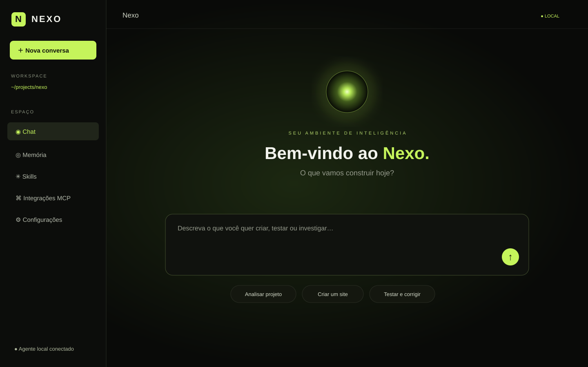
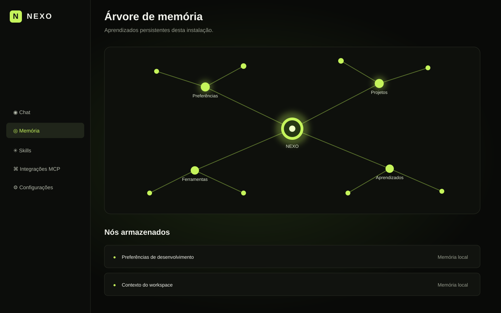

# Nexo — Local AI Workspace

  <strong>Um ambiente de IA local conectado ao workspace e ao terminal da sua máquina.</strong> 
  Interface web local • Agente Node.js • Ferramentas de projeto • Memória persistente

A interface usa como referência visual o conceito enviado: fundo escuro, brilho verde-lima, orb central e navegação lateral. O navegador é apenas a interface; quem acessa arquivos e executa comandos é o agente local iniciado no terminal.

## Referências visuais

### Chat e workspace

### Memória em grafo

As imagens são mockups SVG de documentação baseados nos componentes e estilos atuais do projeto; não são capturas de uma sessão real.

## Requisitos

- Node.js 20.11 ou superior (Node 22 LTS recomendado).
- npm (incluído com Node.js).
- Um provedor de IA com API compatível com o formato Chat Completions usado pelo agente.

## Instalação — Kali Linux, Linux, macOS e Termux

Clone o repositório e execute a instalação:

~~~bash
git clone https://github.com/stylesxzz/NexCode.git
cd NexCode
npm install
~~~

**O comando global `nexcode` é registrado automaticamente durante `npm install`.** O instalador executa o vínculo a partir da raiz do Nexo e substitui um vínculo global antigo do pacote legado `@nexcode/cli`, quando houver. Não é necessário executar `npm link` manualmente.

Se o comando não for encontrado, atualize o cache do shell e confira o diretório global do npm:

~~~bash
hash -r
npm prefix -g
npm config get prefix
~~~

Em Kali/Linux/macOS com Zsh, se o diretório global `bin` não estiver no PATH:

~~~bash
echo 'export PATH="$(npm config get prefix)/bin:$PATH"' >> ~/.zshrc
source ~/.zshrc
~~~

No Termux, o diretório global de executáveis normalmente fica em `$PREFIX/bin`; confirme se ele está no PATH com `echo "$PATH"`.

### Windows (PowerShell)

~~~powershell
git clone https://github.com/stylesxzz/NexCode.git
cd NexCode
npm install
nexcode
~~~

O instalador usa o mecanismo de links do npm, que cria os executáveis apropriados para Windows. Se o comando não aparecer imediatamente, feche e abra o PowerShell.

### Corrigir ou refazer o vínculo global

Se uma instalação anterior deixou um comando global apontando para o pacote antigo, execute **na raiz do repositório** (a pasta que contém o package.json principal):

~~~bash
npm link --force
~~~

Não execute esse comando dentro de `apps/cli`: esse diretório pertence à implementação TUI antiga e não é o launcher do Nexo local.

## Iniciar e reiniciar

Inicie o Nexo a partir da pasta que deseja disponibilizar ao agente:

~~~bash
nexcode
~~~

Ou informe explicitamente o workspace:

~~~bash
nexcode /caminho/para/meu-projeto
~~~

Também é possível definir o workspace por variável de ambiente:

~~~bash
NEXCODE_WORKSPACE=/caminho/para/meu-projeto nexcode
~~~

Windows PowerShell:

~~~powershell
$env:NEXCODE_WORKSPACE = "C:\Users\SeuUsuario\Projeto"
nexcode
~~~

Ao iniciar, o terminal exibe o endereço local e um código de pareamento. Abra **http://127.0.0.1:4173**, digite o código e conecte. Mantenha o terminal aberto enquanto estiver usando o Nexo. Para encerrar, pressione `Ctrl+C`; para reiniciar, execute `nexcode` novamente.

### Porta alternativa

Se a porta padrão estiver ocupada:

~~~bash
NEXCODE_PORT=4180 nexcode
~~~

Depois abra `http://127.0.0.1:4180`.

## Configurar um provedor de IA

Na interface, abra **Configurações** e informe provedor, URL base, identificador do modelo e chave. A chave é armazenada localmente em `~/.nexcode/config.json` (permissão restrita pelo agente).

### NVIDIA NIM — DeepSeek V4 Flash

Endpoint base:

~~~text
https://integrate.api.nvidia.com/v1
~~~

Identificador do modelo original:

~~~text
deepseek-ai/deepseek-v4.1-flash
~~~

**Atenção à disponibilidade:** a página da NVIDIA marca o endpoint gratuito de `deepseek-ai/deepseek-v4-flash` como depreciado e mostra disponibilidade por parceiros. A NVIDIA também lista `deepseek-ai/deepseek-v4.1-flash` como modelo mais recente com endpoint gratuito disponível. Confirme na página do modelo qual endpoint está habilitado para a sua conta antes de configurar.

- [DeepSeek V4 Flash — NVIDIA](https://build.nvidia.com/deepseek-ai/deepseek-v4-flash)
- [DeepSeek V4.1 Flash — NVIDIA](https://build.nvidia.com/deepseek-ai/deepseek-v4.1-flash)
- [Catálogo NVIDIA NIM](https://build.nvidia.com/)

Para testar a chave fora do Nexo, no Kali/Linux/macOS:

~~~bash
read -s -p "NVIDIA API Key: " NVIDIA_API_KEY
echo
curl https://integrate.api.nvidia.com/v1/chat/completions \
  -H "Authorization: Bearer $NVIDIA_API_KEY" \
  -H "Content-Type: application/json" \
  -d '{
    "model": "deepseek-ai/deepseek-v4-flash",
    "messages": [{"role":"user","content":"Responda: Nexo conectado."}],
    "max_tokens": 100,
    "stream": false
  }'
unset NVIDIA_API_KEY
~~~

Se o endpoint gratuito não estiver disponível para V4 Flash, selecione o modelo que aparece habilitado no catálogo e use o identificador exatamente como fornecido pela NVIDIA. Não coloque a chave diretamente no histórico do shell ou em arquivos versionados.

### Outros endpoints OpenAI-compatible

| Provedor | URL base |
|---|---|
| OpenAI | `https://api.openai.com/v1` |
| NVIDIA NIM | `https://integrate.api.nvidia.com/v1` |
| OpenRouter | `https://openrouter.ai/api/v1` |
| Ollama local | `http://localhost:11434/v1` |

A compatibilidade varia por modelo: respostas em formato Chat Completions e chamadas de ferramentas (tool calling) precisam ser suportadas para os fluxos de agente.

## Recursos disponíveis nesta versão

- Interface web local responsiva: Chat, Memória, Skills, Integrações MCP e Configurações.
- Pareamento por código entre navegador e agente local.
- Agente com ferramentas de terminal, leitura, escrita e listagem de arquivos.
- Execução de comandos no workspace configurado, com timeout e limite de saída.
- Memória persistente local e visualização em grafo.
- Instalação e remoção de arquivos `SKILL.md` por URL HTTPS.
- Conexão com servidores MCP remotos via HTTP(S), com descoberta de ferramentas e OAuth quando o servidor publica metadados e permite registro dinâmico de cliente.\n- Respostas do provedor em streaming, com texto aparecendo progressivamente e limite de 90 segundos para evitar espera infinita.\n- Chat ocupa a tela após a primeira mensagem; a tela de boas-vindas desaparece durante a conversa.\n- Anexos de até seis imagens de referência, armazenadas em `.nexo/references/` no workspace e enviadas ao modelo (requer modelo com visão).\n- Geração direta de arquivos PDF, DOCX e ZIP por ferramentas do agente, sem exigir dependências externas.\n- Saída ao vivo de comandos e logs do agente no painel Terminal do chat.\n- Perfis de modelos locais OpenAI-compatible (Ollama, LM Studio, llama.cpp e similares), com seleção do modelo ativo.
- Configurações locais em `~/.nexcode/config.json`.

## Comandos de desenvolvimento

~~~bash
npm start       # inicia o agente sem o launcher global
npm run dev     # reinicia o agente ao detectar alterações
npm test        # executa os testes automatizados
npm run check   # verifica a sintaxe dos arquivos JS
npm run link    # refaz o vínculo global do comando nexcode
~~~

## Dados locais

| Conteúdo | Caminho |
|---|---|
| Configuração e chave de API | `~/.nexcode/config.json` |
| Memória | `~/.nexcode/memory.json` |
| Skills instaladas | `~/.nexcode/skills/` |

Faça backup dessa pasta se quiser preservar configurações e memória ao trocar de máquina. Nunca envie chaves de API para o Git.

## Segurança

O agente executa comandos com os privilégios do usuário que iniciou o processo. A opção de autonomia deve ser habilitada apenas para workspaces confiáveis. Os bloqueios existentes são proteções básicas, não um sandbox de segurança. Revise o workspace, mantenha backups e não exponha a porta local publicamente. O servidor foi projetado para escutar em loopback (`127.0.0.1`).

## Arquivos gerados e referências visuais\n\nO agente pode criar arquivos `.pdf`, `.docx` e `.zip` diretamente na pasta do workspace. Os documentos gerados são arquivos reais, não apenas blocos de texto na conversa. As imagens anexadas no chat são copiadas para `.nexo/references/` dentro do workspace para que possam ser reutilizadas no projeto. A análise visual depende de um modelo multimodal com suporte a imagens.\n\n## Estado de implementação e limitações

Esta é uma reconstrução limpa e funcional em evolução. Para transparência:

- A execução de terminal, leitura, escrita e listagem de arquivos estão disponíveis no agente local.\n- O streaming de resposta depende de o provedor implementar Server-Sent Events no endpoint Chat Completions; respostas JSON convencionais continuam aceitas, mas não aparecem token a token.\n- A geração de PDF usa fontes padrão e layout simples; DOCX contém texto editável básico. Não substitui ferramentas avançadas de editoração.
- Skills podem ser instaladas e removidas, mas ainda precisam ser carregadas automaticamente no contexto do modelo para orientar todas as tarefas.
- A tela MCP permite cadastrar e remover configurações; inicialização dos processos MCP e execução das ferramentas MCP ainda precisam ser concluídas.
- A memória persiste notas e as apresenta em grafo; embeddings, recuperação semântica e gerenciamento individual de nós ainda precisam ser concluídos.
- Integração nativa Anthropic Messages, OAuth, SCP com verificação por e-mail/OTP, streaming e PTY interativo ainda não estão implementados.

## Contribuição

Issues e pull requests são bem-vindos. Antes de enviar alterações, execute:

~~~bash
npm test
npm run check
~~~
