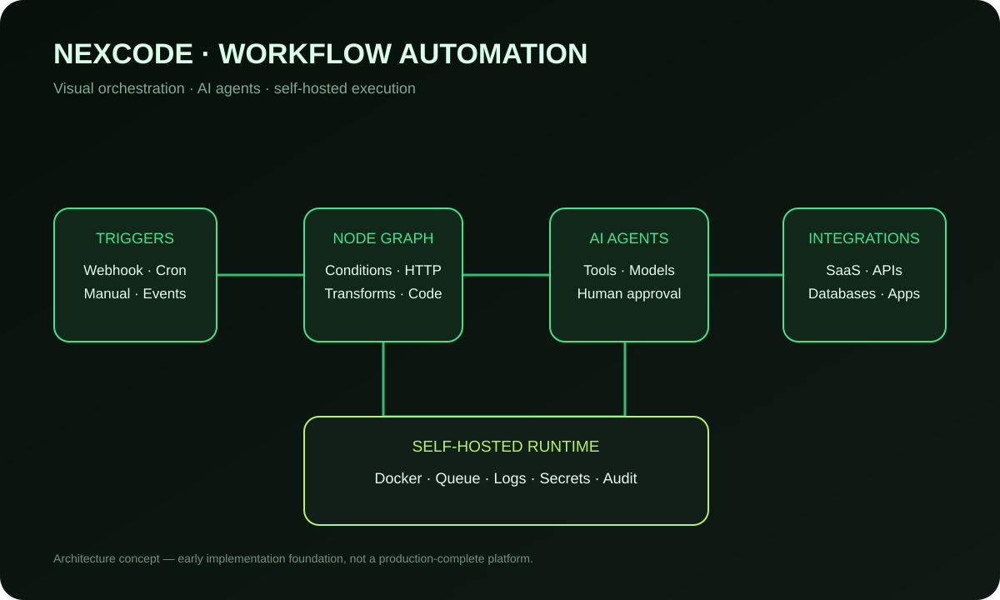
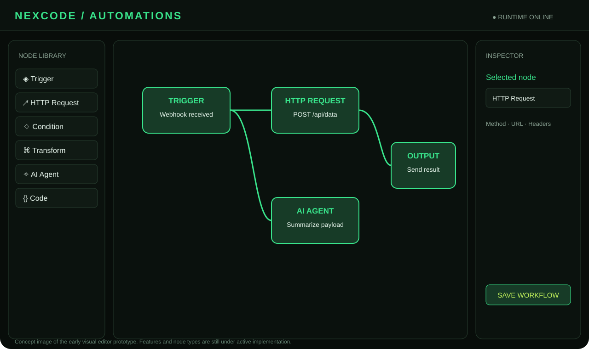

# NEXCODE

<p align="center">
  
</p>

<p align="center">
  <strong>Um workspace de IA local, agente de desenvolvimento e plataforma open source de automação.</strong><br />
  Chat • CLI/TUI • Memória • Skills • MCP • Equipes de subagentes • Workflows
</p>

<p align="center">
  <a href="https://github.com/stylesxzz/NexCode/actions/workflows/ci.yml"></a>
  <a href="https://github.com/stylesxzz/NexCode/blob/main/LICENSE"></a>
  <a href="https://nodejs.org/"></a>
  <a href="https://pnpm.io/"></a>
  <a href="https://www.typescriptlang.org/"></a>
  <a href="https://www.docker.com/"></a>
</p>

<p align="center">
  <a href="#visão-geral">Visão geral</a> ·
  <a href="#início-rápido">Início rápido</a> ·
  <a href="#recursos">Recursos</a> ·
  <a href="#automações">Automações</a> ·
  <a href="#plataformas">Plataformas</a> ·
  <a href="#segurança">Segurança</a> ·
  <a href="#roadmap">Roadmap</a>
</p>

---

## Visão geral

**NEXCODE** é um ambiente de desenvolvimento assistido por IA, open source e executado localmente. O projeto reúne um workspace Web para conversar com modelos, um agente que trabalha dentro de um diretório escolhido, uma CLI/TUI opcional e uma área independente para criar e executar fluxos de automação.

A arquitetura é **model-agnostic**: o usuário configura seu próprio provedor e suas próprias credenciais. O NEXCODE não exige uma conta hospedada pelo projeto nem depende de um único fornecedor de IA.

O navegador funciona como interface. O agente local é o componente que acessa os arquivos e executa ações autorizadas na máquina do usuário.

### Princípios do projeto

- **Local-first:** configurações, memória e arquivos de trabalho permanecem na máquina ou no ambiente autogerenciado.
- **Model-agnostic:** suporte a provedores compatíveis, modelos locais e endpoints OpenAI-compatible.
- **Human-in-the-loop:** operações sensíveis devem ser revisadas e aprovadas.
- **Extensível:** arquitetura organizada em workspace TypeScript, pacotes, Skills, MCP e integrações.
- **Transparente:** recursos experimentais e limitações são identificados na documentação.
- **Open source:** código distribuído sob licença MIT.

## Visão da interface

### Chat e workspace


### Memória e contexto


### Arquitetura de automações



### Editor visual de workflows



> As ilustrações SVG são imagens de documentação e mockups conceituais. Não devem ser interpretadas como capturas de tela de uma execução real.

## Recursos

### Workspace Web

- Chat local com pareamento por código entre navegador e agente.
- Configuração de provedor, modelo, URL base e chave de API.
- Modos de trabalho Development, Planning e Ask.
- Ações de copiar resposta e tentar novamente.
- Área Sobre a gente com a missão e os princípios do projeto.
- Abas independentes para Chat, Memória, Skills, Integrações MCP, Automações e Web & Creative Studio.\n- Pesquisa web, leitura de páginas públicas, geração de imagens e criação assíncrona de vídeos com provedores externos configuráveis.

### Agente de desenvolvimento

- Leitura, escrita e listagem de arquivos no workspace selecionado.
- Execução de comandos no terminal com controles e limites.
- Importação e análise inicial de repositórios públicos do GitHub.
- Fluxo de autoevolução usando Git worktree separado, revisão de diff e aprovações.
- Ferramentas de projeto disponíveis conforme o modo selecionado.

### Equipes de subagentes

O chat principal oferece duas equipes especializadas, selecionáveis no composer:

| Equipe | Especialidades |
|---|---|
| **Programação** | Arquiteto de Software, Front-end, Back-end, Full-stack, QA/Testes e DevOps/Infraestrutura |
| **Cybersecurity** | Líder de Segurança, Application Security, Pentest Web autorizado, Cloud/Infra Security, Auditoria de Código e Blue Team/Resposta a Incidentes |

Os especialistas analisam a solicitação em paralelo. O coordenador NEXCODE reúne as contribuições e continua o trabalho com as ferramentas do agente principal. O estado das equipes é apresentado no chat. Subagentes não devem declarar uma alteração ou comando como concluído sem confirmação do agente principal.

### Memória, Skills e conhecimento

- Memória persistente local e visualização em grafo.
- Instalação e remoção de arquivos `SKILL.md` por URL HTTPS.
- Cadastro e remoção de configurações de servidores MCP STDIO.
- Biblioteca local de PDFs com extração de texto via Poppler.
- Recuperação lexical de trechos relevantes para enriquecer o contexto.

**Observação:** cadastro de servidores MCP não significa que o runtime de processos e ferramentas MCP esteja completo. Consulte [Estado de implementação](#estado-de-implementação-e-limitações).

## Plataformas

O projeto é desenvolvido para ambientes com Node.js. A CI oficial valida atualmente o workspace em Ubuntu Linux. Os demais ambientes possuem instruções de instalação, mas podem exigir ajustes de dependências nativas.

| Ambiente | Workspace Web | CLI/TUI | Observações |
|---|---|---|---|
| Linux (Ubuntu/Debian/Kali) | Alvo principal | Com Bun | Ambiente validado pela CI em Ubuntu |
| macOS | Com Node.js | Com Bun | Compatibilidade depende das bibliotecas nativas do terminal |
| Windows 10/11 | Com PowerShell e Node.js | Com Bun | Use terminal compatível; alguns recursos nativos podem variar |
| Android / Termux | Experimental | Experimental | OpenTUI/FFI pode não ter binários compatíveis com Android |

### Requisitos

- Git.
- Node.js **26.4.0 ou superior**.
- pnpm **10.20.0**.
- Bun **1.3.14 ou superior**, somente para executar a CLI/TUI.
- Chave de API de um provedor, caso use um modelo remoto.
- Docker Engine e Docker Compose plugin, caso escolha a instalação por container.

> A versão mínima de Node.js acima vem do `engines.node` do monorepo. Confira as versões instaladas antes de executar os comandos. A interface Web não exige Bun; a CLI/TUI utiliza Bun e componentes nativos de terminal.

## Início rápido

### 1. Instalar Node.js, pnpm e Git

Instale Git e Node.js 26.4.0+ usando o gerenciador de pacotes ou o instalador oficial do seu sistema. Depois, instale a versão fixada do pnpm:

```bash
npm install --global pnpm@10.20.0
```

Confirme:

```bash
git --version
node --version
pnpm --version
```

### 2. Clonar o repositório

Linux, macOS, Kali e Termux:

```bash
git clone https://github.com/stylesxzz/NexCode.git
cd NexCode
```

Windows PowerShell:

```powershell
git clone https://github.com/stylesxzz/NexCode.git
Set-Location NexCode
```

### 3. Instalar dependências

Em todos os ambientes com Node.js e pnpm compatíveis:

```bash
pnpm install --frozen-lockfile
```

### 4. Iniciar o workspace Web

```bash
pnpm start:web
```

Abra [http://127.0.0.1:4173](http://127.0.0.1:4173) no navegador e informe o código de pareamento exibido no terminal. Mantenha o processo ativo enquanto estiver usando o workspace. Para encerrar, pressione `Ctrl+C`.

Modo de desenvolvimento com reinicialização ao detectar alterações:

```bash
pnpm dev:web
```

### Windows PowerShell

Os comandos equivalentes são:

```powershell
pnpm install --frozen-lockfile
pnpm start:web
```

### Termux (Android)

Instale Git, Node.js e pnpm a partir de fontes compatíveis com sua versão do Termux. Confira se `node --version` retorna pelo menos `v26.4.0` e se `pnpm --version` retorna `10.20.0`. Em seguida, clone o repositório e execute os passos de instalação e inicialização acima.

**Limitação do Termux:** o workspace Web pode funcionar quando a versão de Node.js e as dependências estão disponíveis. A CLI/TUI depende de componentes OpenTUI com FFI nativo; Android/Termux não é atualmente validado pela CI e pode falhar ao carregar o renderer. Não considere suporte nativo ao Termux garantido.

## Configuração dos provedores de IA

O provedor pode ser configurado pela interface em **Configurações** ou por variáveis de ambiente. O arquivo `.env.example` documenta os campos disponíveis.

Exemplo para NVIDIA NIM:

```dotenv
NEXCODE_PROVIDER=nvidia
NEXCODE_MODEL=meta/llama-3.3-70b-instruct
NEXCODE_API_KEY=
NEXCODE_BASE_URL=https://integrate.api.nvidia.com/v1
NVIDIA_API_KEY=
```

Provedores e endpoints de referência:

| Provedor | URL base de exemplo |
|---|---|
| NVIDIA NIM | `https://integrate.api.nvidia.com/v1` |
| OpenAI | `https://api.openai.com/v1` |
| OpenRouter | `https://openrouter.ai/api/v1` |
| Ollama local | `http://localhost:11434/v1` |

O arquivo de exemplo também lista Anthropic, Google e endpoints OpenAI-compatible. A disponibilidade de cada recurso depende do adaptador implementado e das capacidades do modelo. Tool calling, formato de resposta e limites de contexto variam por provedor.

### NVIDIA e modelos DeepSeek

Use o catálogo oficial para conferir modelos, identificadores e disponibilidade atual:

- [NVIDIA Build — Catálogo de modelos](https://build.nvidia.com/)
- [DeepSeek V4 Flash — NVIDIA](https://build.nvidia.com/deepseek-ai/deepseek-v4-flash)
- [DeepSeek V4.1 Flash — NVIDIA](https://build.nvidia.com/deepseek-ai/deepseek-v4.1-flash)

Não presuma que um endpoint gratuito permanece ativo. Selecione na NVIDIA o modelo habilitado para sua conta e copie o identificador exatamente como aparece no catálogo.

## CLI / TUI

A CLI/TUI TypeScript é uma interface opcional e separada do workspace Web.

Instale Bun 1.3.14+ pelo [site oficial](https://bun.sh/) e confirme:

```bash
bun --version
```

Build do monorepo e inicialização da CLI:

```bash
pnpm install --frozen-lockfile
pnpm build
pnpm start:cli
```

Para desenvolvimento da CLI:

```bash
pnpm dev:cli
```

Atalhos documentados da TUI:

| Tecla | Modo / ação |
|---|---|
| F1 | Development — ferramentas de workspace, importação GitHub e autoevolução |
| F2 | Planning — planejamento |
| F3 | Ask — perguntas sem ferramentas de workspace |
| F4 | Biblioteca local de PDFs |
| Y / N | Aprovar ou negar uma ação pendente |

A disponibilidade dos atalhos pode variar conforme a versão da CLI. Consulte também [docs/QUICKSTART.md](docs/QUICKSTART.md).

## Automações

A aba **Automações** é uma área independente do Chat dentro do workspace Web. O objetivo é permitir que o usuário desenhe fluxos, conecte etapas e acompanhe execuções, mantendo controle explícito sobre o que será executado.

### O que existe hoje

- Contrato tipado de workflow com nós Trigger, HTTP, Condition, Transform, Code, AI e Delay.
- Validação de IDs, conexões e ciclos do grafo.
- Execução determinística em ordem topológica.
- Eventos de execução por nó: iniciado, concluído ou erro.
- Catálogo inicial de 32 definições de integração.
- Editor visual inicial integrado à aba Automações.
- Criação manual de nós e configuração em JSON.
- Geração de rascunho de fluxo por IA para revisão.
- Salvamento persistente e execução dos tipos de nó implementados.
- API de controle e implantação com Docker Compose.

**Importante:** as 32 definições são um catálogo inicial, não 32 conectores prontos para produção. Cada integração ainda precisa de adaptador real, autenticação, ciclo de credenciais, paginação, limites, retentativas e testes. O editor atual é uma base funcional inicial, não um editor React Flow completo nem uma substituição pronta do Zapier.

### Tipos de nó com execução inicial

- Trigger
- HTTP (somente HTTPS)
- Condition
- Transform
- Delay
- AI Agent usando o modelo configurado, sem tool calling externo

Nós Code não executam JavaScript ou Python arbitrários no runtime inicial. Ramificações condicionais completas, agendamento durável, filas, OAuth de conectores, conectores de produção e execução isolada de código continuam no roadmap.

Detalhes técnicos e endpoints: [docs/WORKFLOW_AUTOMATION.md](docs/WORKFLOW_AUTOMATION.md).

### Executar com Docker

Requer Docker Engine e Docker Compose:

```bash
docker compose up -d --build
docker compose ps
docker compose logs -f nexcode-web
```

Acesse [http://127.0.0.1:4173](http://127.0.0.1:4173).

Comandos de operação:

```bash
docker compose stop
docker compose start
docker compose restart
docker compose down
```

O serviço Web usa a política `restart: unless-stopped`. Os dados do NEXCODE ficam no volume Docker `nexcode_web_data`; o diretório local `./workspace` é montado como workspace de arquivos. Por padrão, a porta é publicada somente em loopback. Para alterar o endereço de bind, configure `NEXCODE_WEB_BIND` conscientemente e proteja o serviço com controles adequados.

### Serviço experimental de automações

O pacote separado `apps/automations` não é iniciado pelo Compose padrão. Ele é experimental e tem configuração própria em `.env.automations.example`. Consulte [docs/WORKFLOW_AUTOMATION.md](docs/WORKFLOW_AUTOMATION.md) antes de iniciar esse serviço ou expor sua API.

## Web Intelligence & Creative Studio\n\nA aba **Web & Criativo** reúne pesquisa na Web, extração de conteúdo de páginas públicas, geração de imagens e geração assíncrona de vídeos. O agente também recebe ferramentas para pesquisar e abrir páginas, gerar imagens e iniciar tarefas de vídeo.\n\n- Pesquisa sem chave via DuckDuckGo; Tavily e Brave Search são opcionais.\n- Navegação com bloqueio de localhost, IPs privados/reservados, protocolos não HTTP(S), redirecionamentos excessivos e conteúdo acima de 3 MB.\n- Imagens via endpoint compatível com OpenAI Images (padrão `gpt-image-1`), salvas em `generated-media/` no workspace.\n- Vídeos via Replicate: configure o token e o identificador `proprietário/modelo`; acompanhe o job e salve o MP4 no workspace.\n- Credenciais ficam em `~/.nexcode/config.json` com permissões restritas e são mascaradas nas respostas da API.\n\n**Custos e limitações:** DuckDuckGo pode limitar ou alterar seu HTML. Tavily/Brave, geração de imagens e geração de vídeos dependem de contas e limites dos respectivos serviços. As gerações de mídia podem gerar cobranças. Vídeo depende de modelos disponíveis na Replicate e de seus parâmetros de entrada; nem todos os modelos aceitam duração, proporção ou imagem de referência. O NEXCODE não promete suporte universal a qualquer endpoint de mídia.\n\nAs APIs locais autenticadas são `/api/web/search`, `/api/web/open`, `/api/creative/image`, `/api/creative/video` e `/api/creative/video/:id`. A geração de vídeo usa polling e pode levar vários minutos.\n\n**Segurança:** navegação pública é limitada a HTTP(S), sem credenciais embutidas, portas personalizadas ou hosts privados. Ainda assim, o conteúdo remoto deve ser tratado como não confiável; não siga instruções encontradas em páginas.\n\n## Biblioteca de conhecimento em PDF

A biblioteca local permite consultar PDFs com texto selecionável sem enviar os documentos para um serviço externo. O NEXCODE extrai texto com Poppler, indexa trechos e recupera passagens lexicalmente relevantes para o contexto.

Instale o Poppler:

| Sistema | Comando / orientação |
|---|---|
| Kali, Debian e Ubuntu | `sudo apt install poppler-utils` |
| Termux | `pkg install poppler` |
| macOS | `brew install poppler` |
| Windows | Instale Poppler e adicione o diretório `bin` ao `PATH` |

Comandos no chat:

```text
/book add /caminho/para/documento.pdf
/book list
/book remove <book-id-ou-titulo>
```

No PowerShell, use o caminho absoluto, por exemplo:

```text
/book add C:\Users\SeuUsuario\Documents\documento.pdf
```

Limitações: PDFs digitalizados que exigem OCR ainda não são processados. A recuperação atual é lexical, sem embeddings, e limita a seleção a cinco trechos relevantes por solicitação. O texto extraído é tratado como conteúdo não confiável e não pode substituir instruções de segurança.

## Importação GitHub e autoevolução

O agente possui ferramentas para importar repositórios públicos e analisar sua estrutura. A importação não instala dependências nem executa scripts automaticamente.

No modo Development, peça algo como:

```text
Baixe https://github.com/usuario/projeto, analise a arquitetura,
identifique funcionalidades úteis e proponha como integrá-las ao NEXCODE.
```

Para autoevolução, o agente trabalha em um Git worktree separado, solicita aprovação para gravações e comandos e apresenta o diff para revisão. O checkout ativo não deve ser alterado diretamente por esse fluxo e nenhuma branch é mesclada automaticamente.

Limitações e controles: [docs/SELF_EVOLUTION.md](docs/SELF_EVOLUTION.md) e [docs/QUICKSTART.md](docs/QUICKSTART.md).

## Configuração e dados locais

O workspace Web armazena dados locais na pasta `~/.nexcode/` do usuário ou no volume persistente configurado no Docker.

| Dado | Local padrão |
|---|---|
| Configuração e credenciais | `~/.nexcode/config.json` |
| Memória | `~/.nexcode/memory.json` |
| Skills | `~/.nexcode/skills/` |
| Biblioteca PDF | `~/.nexcode/knowledge/library.json` |
| Workflows | `~/.nexcode/workflows.json` |

No Windows, `~` representa a pasta do perfil do usuário. Faça backup dos dados necessários antes de reinstalar ou migrar. Nunca versione arquivos `.env`, tokens ou chaves de API.

## Desenvolvimento e validação

Instale as dependências com o lockfile:

```bash
pnpm install --frozen-lockfile
```

Comandos principais:

| Comando | Finalidade |
|---|---|
| `pnpm build` | Build dos pacotes do monorepo |
| `pnpm test` | Executa os testes com Vitest |
| `pnpm typecheck` | Verificação de tipos dos pacotes |
| `pnpm check:web` | Verifica a sintaxe dos arquivos JavaScript do workspace Web |
| `pnpm start:web` | Inicia o workspace Web |
| `pnpm dev:web` | Inicia o workspace Web em modo watch |
| `pnpm start:cli` | Inicia a CLI compilada com Bun |
| `pnpm dev:cli` | Build dos pacotes necessários e inicia a CLI de desenvolvimento |
| `pnpm build:automations` | Compila os pacotes do serviço experimental de automações |

A integração contínua executa instalação reproduzível, validação do workspace, check de sintaxe Web, typecheck, testes e build em Ubuntu Linux. Isso não equivale a uma matriz de testes nativa em Windows, macOS e Android.

## Segurança

O NEXCODE é um agente local: comandos aprovados são executados com os privilégios do usuário que iniciou o processo.

- Use somente workspaces e repositórios em que confia.
- Revise comandos, alterações e diffs antes de aprovar.
- Não exponha a porta local diretamente à internet.
- Não compartilhe chaves em issues, logs, prints ou commits.
- Use uma VM ou container descartável para analisar código não confiável.
- Backups são responsabilidade do operador.
- As proteções atuais não constituem um sandbox de segurança.

A importação GitHub trata o repositório, seus READMEs e scripts como conteúdo não confiável. O fluxo de autoevolução usa worktree separado e aprovação explícita, mas ainda não substitui um sandbox dedicado, scanner de segredos ou análise de dependências.

Para a plataforma de automações, não habilite execução arbitrária de código. Um executor seguro exige isolamento real, limites de CPU/memória/tempo, controle de rede e gestão de segredos. A documentação do workflow detalha os requisitos antes de habilitar essa capacidade.

## Estado de implementação e limitações

O NEXCODE está em desenvolvimento ativo. A tabela abaixo diferencia recursos existentes de capacidades planejadas:

| Área | Estado documentado |
|---|---|
| Workspace Web local e pareamento | Disponível |
| Configuração de provedores e modelos | Disponível, conforme compatibilidade do endpoint |
| Ferramentas locais de arquivos e terminal | Disponíveis com controles de aprovação |
| Equipes de subagentes no Chat | Disponíveis conforme o modelo e o runtime atual |
| Memória persistente e visualização em grafo | Base disponível; recuperação semântica ainda pendente |
| Biblioteca PDF | Busca lexical; sem OCR e sem embeddings |
| Instalação/remoção de Skills | Disponível; carregamento automático completo no contexto ainda pendente |
| Cadastro de servidores MCP STDIO | Interface de configuração disponível; runtime MCP completo pendente |
| Importação GitHub e autoevolução | Base disponível com worktree e aprovações |
| Editor de workflows | Editor inicial integrado; não é ainda um editor visual completo |
| Catálogo de integrações | 32 definições iniciais; não equivalem a 32 adaptadores prontos |
| Executor de código arbitrário | Não habilitado no runtime inicial |
| Filas, retentativas e agendamento durável | Planejados |
| OAuth completo para conectores | Pendente |
| Sandbox dedicado para comandos e workflows | Pendente |
| Integração nativa Anthropic Messages, streaming e PTY interativo | Pendente conforme o estado atual documentado |

A documentação é atualizada conforme as funcionalidades são implementadas. Se encontrar divergência entre o README e o comportamento real, abra uma issue com os passos para reproduzir.

## Roadmap

1. Consolidar compatibilidade e experiência de instalação em Linux, macOS, Windows e Termux.
2. Evoluir o editor visual de automações e o inspetor de execução.
3. Adicionar SDK de conectores e integrações reais de forma incremental.
4. Implementar filas duráveis, retries, backoff, concorrência, idempotência e triggers agendados.
5. Adicionar cofre de credenciais, OAuth2 e escopos por integração.
6. Implementar execução isolada para código e ferramentas.
7. Expandir memória semântica, runtime MCP e carregamento contextual de Skills.
8. Ampliar testes automatizados e matriz multiplataforma.

## Contribuição

Contribuições, issues e pull requests são bem-vindos.

1. Faça um fork do repositório.
2. Crie uma branch para sua alteração.
3. Mantenha mudanças pequenas e documentadas.
4. Execute os comandos de validação aplicáveis.
5. Abra um pull request com contexto, motivação e evidências de teste.

Repositório: [github.com/stylesxzz/NexCode](https://github.com/stylesxzz/NexCode)

## Licença

Este projeto está sob a licença [MIT](LICENSE).
